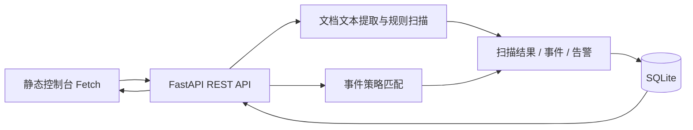

# 实现与联调说明

## 请求流

## 文件扫描流程

`POST /api/v1/projects/{project_id}/files` 使用 multipart 上传；`auto_scan=true` 时在同一请求内完成写盘、文本提取与扫描，返回 `file_id`、`scan_task_id`、`risk_score`、`risk_level` 等字段。

控制台继续请求 `GET /api/v1/scans/{task_id}/result` 展示 `findings`，通过告警列表和详情接口展示证据。当前 `scan_tasks` 是过程记录，并不是后台任务队列。

- PDF：pypdf 读取前 30 页的可提取文本。
- DOCX：python-docx 读取段落和表格单元格。
- 扫描：关键词检测、敏感内容正则和可疑 URL 启发式规则。
- 解析异常：当前实现回退到字节解码；它不是可靠的格式恢复机制，后续应改成明确的解析失败状态与受控重试。

## 策略检测流程

`POST /api/v1/events` → `record_event` → `match_event_policy` → SQLite 事件记录 → 告警生成。

`P-FILE-001` 对路径关键词匹配，`P-DOC-001` 对上下文关键词匹配，`P-API-001` 对 API 事件匹配。API 策略在当前状态码为 401/403/404 或含异常信号时，统计同项目/同 actor 的窗口内全部 `api.request`，加上当前请求计数与阈值比较。默认窗口 60 秒、阈值 10。当前算法不能精确表示“只统计异常请求”。

`GET/PUT /api/v1/policies/{policy_id}` 支持配置更新；前端配置页目前提供启停、等级与处置动作控件，阈值通过接口修改。

## 数据及界面

业务数据存于 SQLite，连接启用 WAL。没有并发压测证据，不据此宣称高并发能力。前端与后端同源部署，使用 `window.location.origin + '/api/v1'` 请求接口。

主要联调字段：`project_id`、`file_id`、`scan_task_id`、`event_id`、`alert_id`、`risk_level`、`decision`、`evidence`、`matched_rules`。接口模式见 [`openapi.json`](evidence/openapi.json)。

## 尚未实现的能力

登录、租户鉴权、文件大小及资源配额、完整输入输出安全处理、异步任务、真实工具执行拦截、生产网络部署与压力测试均不作为现有成果。原型只在本机演示合成样本。

评测只覆盖 7 个内置案例。`detection_rate` 实际为期望处置匹配比例，`false_positive_rate` 为占位值，耗时为本地样例处理时间，不能代表线上延迟或真实安全效果。
